# Mise en œuvre de la solution

## 1. Architecture proposée

```
                              INTERNET
                                 │
                        ┌────────┴─────────┐
                        │  ROUTER/FIREWALL  │  ← pfSense
                        └────────┬─────────┘
                                 │
              ┌──────────────────┴──────────────────┐
   ACCESSPOINT│                SwitchCore            │  SERVER/LDAP
   (Wi-Fi) ───┤                                       ├── (VLAN 40 — 192.168.40.0/24)
              └──┬───────────┬───────────┬────────────┘
                 │           │           │
           CLIENT/VLAN10  CLIENT/VLAN20  CLIENT/VLAN30
           IT              STAFF          INVITE
           192.168.10.0/24 192.168.20.0/24 192.168.30.0/24
```

Architecture existante avant le projet, avec un seul réseau plat :

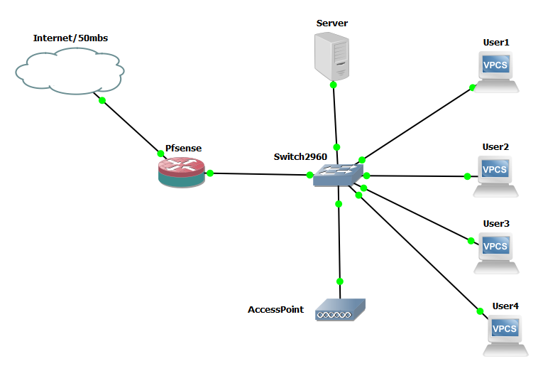

Architecture cible avec segmentation VLAN :

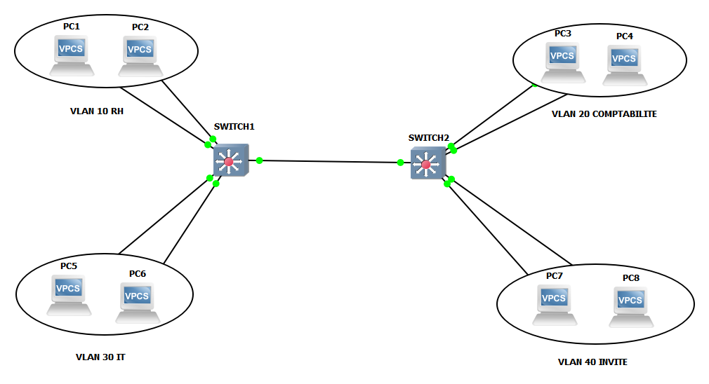

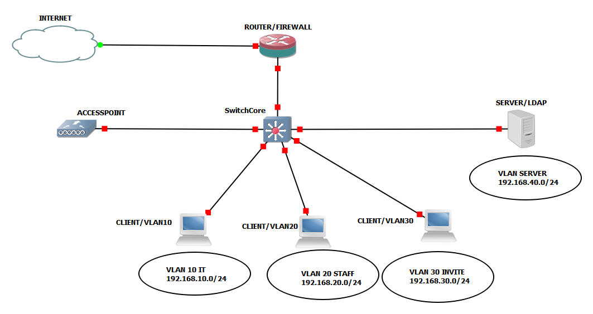

## 2. Équipements utilisés

| Équipement | Rôle |
|---|---|
| Switch Cisco niveau 2 | Configuration des VLANs et affectation des ports |
| Câbles RJ45 | Interconnexion des équipements |
| Routeur pare-feu (pfSense) | Filtrage, portail captif, serveur DHCP |
| Hyperviseur VMware | Virtualisation des machines |
| Simulateur GNS3 | Simulation de l'architecture réseau |

## 3. Plan d'adressage

| ID_VLAN | VLAN | Adressage |
|---|---|---|
| 10 | IT | 192.168.10.0/24 |
| 20 | STAFF | 192.168.20.0/24 |
| 30 | INVITE | 192.168.30.0/24 |
| 40 | SERVEUR | 192.168.40.0/24 |

---

## 4. Configuration du switch

> 📄 Commandes CLI détaillées dans [`../configs/switch-config.md`](../configs/switch-config.md)

1. Sécurisation basique du switch (mot de passe `enable`) ;
2. Création des 4 VLANs (10-IT, 20-STAFF, 30-INVITE, 40-SERVER) ;
3. Affectation des ports :
   - Gi0/1-3 → VLAN 10
   - Gi1/0-3 → VLAN 20
   - Gi2/0-3 → VLAN 30
   - Gi3/2 → VLAN 40
4. Configuration d'un lien **trunk (802.1Q)** sur le port Gi0/0 relié à pfSense.

Sécurisation du switch et création des VLANs en CLI :

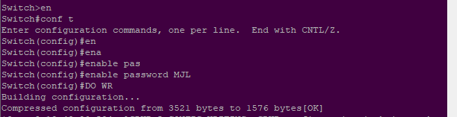

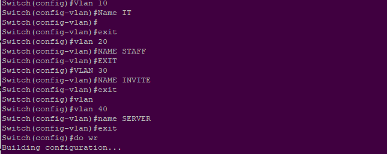

Affectation des ports par VLAN :

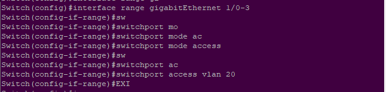

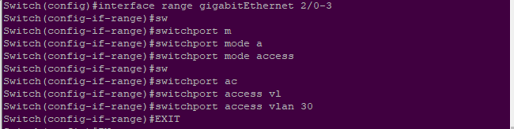

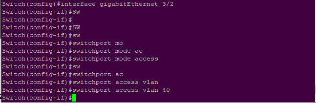

---

## 5. Installation et configuration de pfSense

> 📄 Étapes détaillées dans [`../configs/pfsense-config.md`](../configs/pfsense-config.md)

**Prérequis :** GNS3 installé, hyperviseur pour la GNS3 VM, image pfSense (ISO + QCOW2).

1. Installation de l'appliance pfSense dans GNS3 ;
2. Configuration réseau initiale (interface à 192.168.1.1/24) ;
3. Déclaration des VLANs sur le routeur (`Interfaces > VLANs`) ;
4. Affectation de chaque VLAN à une interface logique ;
5. Activation et adressage de chaque interface (ex : IT → 192.168.10.1/24) ;
6. Création du pool DHCP par VLAN.

Importation de l'appliance pfSense dans GNS3 et déclaration d'une interface VLAN :

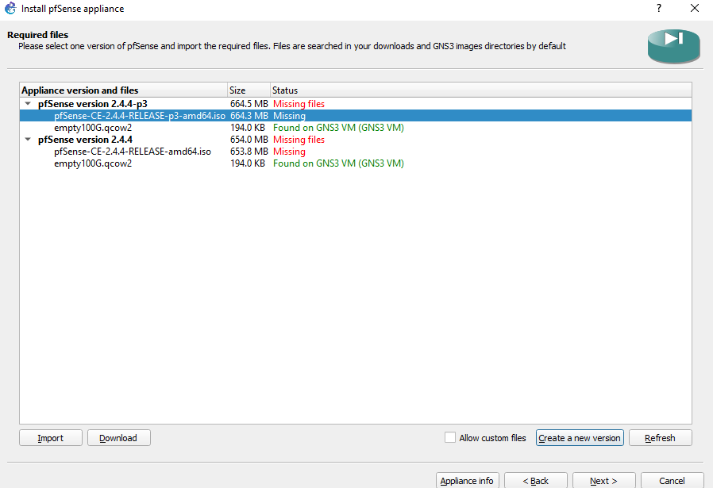


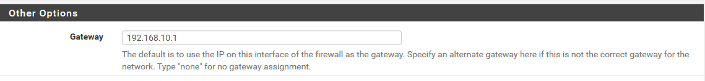

---

## 6. Mise en place du portail captif

Deux portails distincts :

| Portail | Interfaces | Serveur d'authentification |
|---|---|---|
| Personnel | STAFF, INVITE | LDAP |
| Invités | INVITE | Base locale (Local Database) |

Étapes (`Services > Captive Portal`) :
1. Créer une zone (ex. `PERSONNEL`) et l'activer ;
2. Sélectionner les interfaces concernées (STAFF, INVITE) ;
3. Définir le timeout d'inactivité (ex. 120 min) ;
4. Spécifier l'URL de redirection après authentification ;
5. Sélectionner le serveur d'authentification (LDAP ou base locale) ;
6. Pour les invités : créer un groupe `INVITE` avec le privilège *"Captive Portal login"*, puis un compte utilisateur rattaché à ce groupe.

> ⚠️ Le VLAN **IT** n'est pas soumis au portail captif (accès direct réservé aux administrateurs).

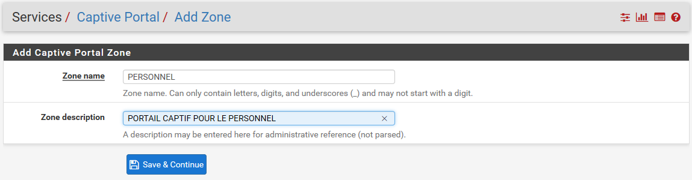

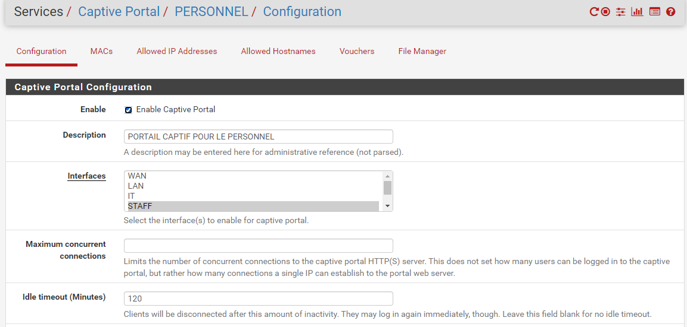

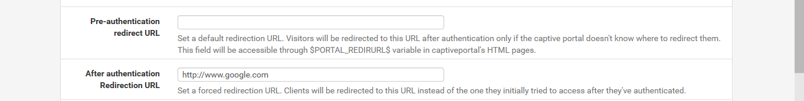

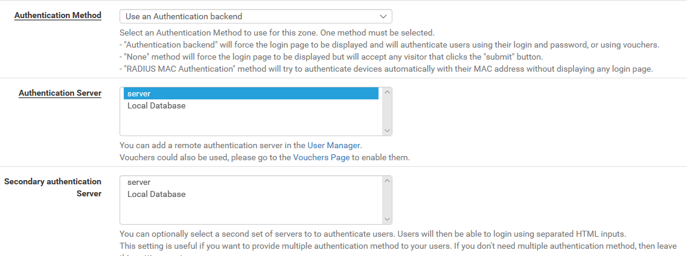

Page de connexion présentée aux utilisateurs STAFF et INVITE :


---

## 7. Optimisation de la bande passante (PfBlockerNG)

1. Installer le paquet (`System > Package Manager` → `PfBlockerNG` version `devel`) ;
2. L'activer (`Firewall > pfBlockerNG > General`) ;
3. Configurer les flux DNSBL (`DNSBL > DNSBL Groups`) — ex. groupe `SOCIAL` ;
4. Ajouter des domaines personnalisés à bloquer (`DNSBL Custom_List`) — sites de streaming, torrents ;
5. Appliquer les configurations (`Update > Run`).

> 💡 Contexte : les invités consommaient ~75% de la bande passante Wi-Fi, d'où l'importance de restreindre leur accès.

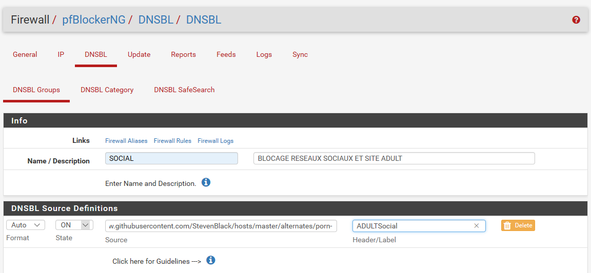

---
[⬅ Retour au README](../README.md) | [Voir les résultats ➡](02-results.md)
